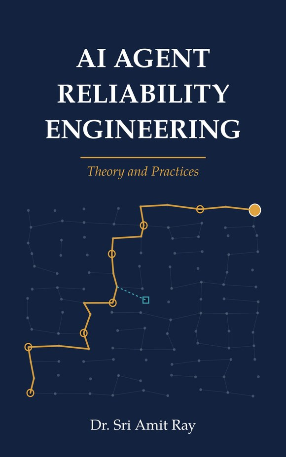

# AI Agent Reliability Engineering: companion laboratory and Forms Workbook

[](https://github.com/compassionate-ai-lab/ai-agent-reliability/actions/workflows/tests.yml)
   



Companion code and worksheets for the book **AI Agent Reliability Engineering: Theory and Practices** by Dr. Sri Amit Ray ([Compassionate AI Lab](https://amitray.com/compassionate-ai-lab/), First edition, 2026; ISBN 978-81-69641-40-1).

[The book](https://amitray.com/ai-agent-reliability-engineering-ebook/) turns a hard problem into an engineering discipline: AI agents that demonstrate well but fail at work. They call the wrong tool, act on stale evidence, retry until they duplicate a payment, or report success for a change that never reached the database. This repository holds the laboratory behind every worked example in the book: the running example **FlexiAgent**, the models printed as the book's 23 numbered listings, 80 unit tests, the expected results and the editable Forms Workbook. Everything runs offline on synthetic data.

## What Is Agentic Reliability?

In [*AI Agent Reliability Engineering*](https://amitray.com/ai-agent-reliability-engineering-ebook/), agentic reliability is the demonstrated ability of a system to carry an authorized task from its starting state to a verified acceptable result, within its operating conditions, time and resource limits, while preserving the obligations that apply throughout. The unit of reliability is the **accepted mission**: the specified outcome, valid authority, every mandatory condition satisfied and sufficient verification evidence, within budget.

> "The agent's final statement and the world's final state are different objects." (Chapter 1)

A correct address written to the wrong person's order is a failure. So is a convincing confirmation with no database update. The book therefore writes a **mission contract** before execution (eligible task, intended result, permitted effects, required evidence, deadline, budget and the disposition on failure) and measures missions against it.

The book analyses reliability through seven functional responsibilities, each with its own contract and its own tests:

1. **Mission and authority:** the contract, permitted effects and who may approve, stop or revoke.
2. **Context and evidence:** fresh, sourced inputs, with stale evidence detected before it is used.
3. **Planning and decisions:** bounded plans with step and budget limits and truthful stopping.
4. **Memory and state:** admission, correction, isolation and deletion that can be tested.
5. **Tools and effects:** typed actions, durable operation identities and idempotent commits.
6. **Coordination and scheduling:** unique ownership, typed handoffs and joint budgets across agents.
7. **Verification and recovery:** authoritative reads, checkpoints and reconciliation after uncertain outcomes.

The Compassionate AI perspective of [Sri Amit Ray's Compassionate AI Architecture (CAIA™)](https://amitray.com/compassionate-ai-architecture/) gives the work its human purpose. Reliability should protect people from preventable harm, preserve meaningful human control and create useful progress, and each commitment is expressed as an obligation that can be enforced and tested.

### Why component scores cannot certify a mission

Chapter 3 takes a mission of eight required steps, each successful 98% of the time. Independence would give 0.98<sup>8</sup> = **0.8508**. With only the marginals known, the mission probability can lie anywhere from **0.84** to **0.98**, and those bounds are sharp. Dependence cuts both ways: two required steps that fail on the same 10% of tasks give 90% success, while disjoint failures give 80%. The book therefore defines the mission event first and estimates its probability second.

### What the book provides

- **Contract and measurement** (Parts I–II): the mission contract, a failure taxonomy, the mathematics of mission reliability, exact confidence bounds, simultaneous error budgets and the **Agentic Reliability Index (ARI)**: seven core protocols for outcomes, repeatability, recovery, control, state, multi-agent coordination and registered stress, plus three architectural views.
- **Dependable execution** (Parts III–IV): workflow architectures, tool transactions with durable operation identities, bounded planning, checkpoints and reversible execution, retrieval, memory integrity, protocol security, and multi-agent and multi-layer dynamics with propagation bounds that report *decays*, *grows* or *inconclusive*.
- **Evidence** (Part V): evaluators and ground truth, fault injection, regression experiments and a reproducible benchmark.
- **Operations** (Part VI): observability, mission SLOs and error budgets, change control, model migration, incidents and drift.
- **People and value** (Parts VII–VIII): human authority and effective oversight, compassionate reliability, assurance and procurement, three applied capstones, the economics of reliable agent work, investor due diligence, a scalable operating model and the future of reliable autonomous systems.

## Sri Amit Ray quotes from the book

> "Capability expands what an agent can attempt. Reliability engineering establishes which responsibilities it can be trusted to carry." (Preface)

> "Uncertainty is a state with its own exit, not a failure to be papered over by optimism." (Chapter 1)

> "A checkpoint that cannot be trusted is worse than none, because it restores a wrong state with confidence." (Chapter 12)

> "A suggestion is not consent." (Chapter 25)

> "A refusal may be appropriate for a forbidden request; abandonment is not an acceptable substitute for a required human referral." (Chapter 26)

> "Reliability work is often everyone's concern and no one's job." (Chapter 31)

## Run it

```sh
git clone https://github.com/compassionate-ai-lab/ai-agent-reliability.git
cd ai-agent-reliability/companion
python -m unittest -v test_reliability test_models   # 80 tests
python run_experiments.py
python calculations.py
python scorecard.py
python architecture_experiment.py
python capstones.py
```

Python 3.11 or later; standard library and `sqlite3` only (NumPy is optional and used by one cross-check test). Scripts write to `companion/results/`; the reference outputs of this release are in `companion/expected_results/`. The GitHub Actions workflow runs the tests on Python 3.11–3.13.

```python
from metrics import lower, gate
from models import radius_bracket, decay_verdict, required_n

print(round(lower(960, 1000, 0.05), 4))        # 0.9482  exact one-sided lower bound
print(required_n(0.99, 0.95))                  # 93      missions for a 95% target
b = radius_bracket([[0.2, 0.3], [0.4, 0.1]])
print(decay_verdict(b))                        # decays  (enclosure below one)
print(decay_verdict(radius_bracket([[0, 1], [1, 0]])))   # inconclusive (radius 1)
print(gate(False, False, 0))                   # Insufficient evidence
```

## What the program computes

| Book | Function(s) | Purpose |
|---|---|---|
| Ch 1, Listing 1.1 | `templates/mission_contract.json` | The reusable mission contract: outcome, invariants, evidence, assistance and unresolved policies, system identity |
| Ch 2, Listing 2.1 | `IncidentRecord`, `controls` | Structured incident record and the controls it implicates |
| Ch 3, Listing 3.1 | `finite_horizon` | Finite-horizon acceptance for a transient-state mission model |
| Ch 4, Listings 4.1–4.2 | `flexiagent.execute`, the commit core | Bounded execute–reconcile–verify path; atomic compare-and-update with durable operation receipts |
| Ch 5, Listings 5.1–5.2 | `metrics.lower`, `qualifies`, `required_n` | Exact one-sided binomial lower bound; missions needed for a target bound |
| Ch 6, Listing 6.1 | `metrics.weighted`, `metrics.gate`, `scorecard.build` | Weighted simultaneous bound and the ordered release status: hard gate, then evidence, then thresholds; every reason listed |
| Ch 7–8, Listings 7.1, 8.1 | `brier`, `coverage_risk`, `zero_event_n`, `cvar` | Forecast quality, selective automation, zero-event planning and tail harm |
| Ch 9, Listing 9.1 | `advance` | Pure transition validator; concurrency comes from the atomic update in Ch 10 |
| Ch 11, 13, 15 | `stalled`, `SourceEnvelope`, `eligible`, `effective_scope`, `permitted` | Progress monitoring, source eligibility, effective scope as an intersection |
| Ch 16, Listing 16.1 | `radius_bracket`, `decay_verdict`, `upper_matrix`, `radius_upper` | Guaranteed spectral-radius enclosure for propagation; unknown edges bounded by 1 |
| Ch 17, 19, 20 | `corrected_rate`, `mcnemar_exact`, `manifest` | Evaluator error correction, exact paired comparison, content-addressed benchmark manifest |
| Ch 21, Listing 21.1 | `MissionEvent`, `claim_audit`, `false_completion` | Each completion claim checked at report time and at final adjudication |
| Ch 22, 26, 29, 32 | `burn_rate`, `ewma`, `subgroup_check`, `incremental_value`, `supported` | Error-budget burn, subgroup floors an overall rate cannot override, value of a control, supported envelope |

The inputs are small illustrative values chosen so that every step can be checked by hand. Deterministic fixture counts describe the finite teaching suite, not a live model. The ARI is an engineering proposal for implementation and testing: register your own populations, thresholds and stresses, and add a test for each case you rely on.

## Forms Workbook

`AI_Agent_Reliability_Engineering_Forms_Workbook_v1.0.0.docx` is an editable Word workbook with five forms:

1. Mission contract
2. Sampling and confidence plan
3. Reliability card
4. Release decision record
5. Incident and remediation record

Appendix C of the book adds ten operational templates. Purchasers of the book may reproduce the forms for their own use and within their organisations.

## The book in brief

- **Part I, Foundations and the Reliability Contract:** 1 From Agent Demonstrations to Dependable Work · 2 A Failure Taxonomy for Agentic Systems · 3 Mathematical Foundations of Mission Reliability · 4 Build the Baseline and Define the Business Case
- **Part II, Measurement and Agentic Reliability Indexes:** 5 Designing a Defensible Measurement Program · 6 The Agentic Reliability Index Suite · 7 Repeatability, Predictability, and Generalization · 8 Tail Harm and Evidence-Based Release Decisions
- **Part III, Architectures That Preserve Dependable Execution:** 9 Choosing Reliable Workflow Architectures · 10 Tool Transactions and Reliable Side Effects · 11 Bounded Planning and Long-Horizon Work · 12 Recovery, Checkpoints, and Reversible Execution
- **Part IV, Context, Memory, Tools, and Reliability Across Agents and Layers:** 13 Reliable Context Retrieval and Evidence · 14 Memory Integrity and Controlled Adaptation · 15 Protocol Boundaries and Agent Security · 16 Multi-Agent and Multi-Layer Reliability Dynamics
- **Part V, Evaluation, Stress Testing, and Reproducible Evidence:** 17 Evaluators, Oracles, and Ground Truth · 18 Fault Injection, Chaos, and Adversarial Testing · 19 Regression Experiments and Causal Comparisons · 20 A Reproducible Reliability Benchmark
- **Part VI, Production Operations and Continuous Reliability:** 21 Observability for Agent Missions · 22 Mission SLOs, Error Budgets, and Operational Decisions · 23 Deployment, Change Control, and Model Migration · 24 Incidents, Drift, and Continuous Improvement
- **Part VII, Human Authority, Assurance, and Applied Systems:** 25 Human Authority and Effective Oversight · 26 Compassionate Reliability and Human Consequences · 27 Enterprise Assurance, Procurement, and Accountability · 28 Three Applied Reliability Capstones
- **Part VIII, Economics, Investment, and the Next Generation:** 29 The Economics of Reliable Agent Work · 30 Investor Due Diligence for Agentic Businesses · 31 Building a Scalable Reliability Operating Model · 32 The Future of Reliable Autonomous Systems
- **Appendices:** A Notation and the Companion Laboratory · B ARI Measurement Specification · C Contracts and Operational Templates · D Exercise Solutions and Laboratory Extensions · E Derivations and Advanced Models
- **Back matter:** Glossary · References · Index · About the Author

## Get the book

- Full-color PDF eBook (380 pages, with the companion laboratory and Forms Workbook attached): [amitray.com/ai-agent-reliability-engineering-ebook](https://amitray.com/ai-agent-reliability-engineering-ebook/)
- Companion page with the download and checksum: [sriamitray.com/books/ai-agent-reliability](https://sriamitray.com/books/ai-agent-reliability/)
- Kindle and paperback: see the book page for current publication links.
- Related volumes with code: *Ethical AI Systems* ([compassionate-ai-lab/ethical-ai-systems](https://github.com/compassionate-ai-lab/ethical-ai-systems)), *Ahimsa in Agentic AI* ([compassionate-ai-lab/ahimsa-in-agentic-ai](https://github.com/compassionate-ai-lab/ahimsa-in-agentic-ai)) and *No-Harm Principles in AI Architectures* ([compassionate-ai-lab/no-harm-principles](https://github.com/compassionate-ai-lab/no-harm-principles)).

## Related published books

1. Ray, Sri Amit. *Ethical AI Systems: Frameworks, Principles, and Advanced Practices for the Age of Autonomous Intelligence*. Revised expanded ed., Compassionate AI Lab, 2026. ISBN 978-81-69641-39-5. Companion code: <https://github.com/compassionate-ai-lab/ethical-ai-systems>
2. Ray, Sri Amit. *No-Harm Principles in AI Architectures: Ahimsa-Driven Multi-Agent AI Systems*. Compassionate AI Lab, 2026. ISBN 978-81-69641-30-2. Companion code: <https://github.com/compassionate-ai-lab/no-harm-principles>
3. Ray, Sri Amit. *Ahimsa in Agentic AI: Algorithmic Non-Violence and the Architecture of Compassionate Code*. Compassionate AI Lab, 2026. ISBN 978-81-69641-29-6. Companion code: <https://github.com/compassionate-ai-lab/ahimsa-in-agentic-ai>
4. Ray, Sri Amit. *Compassionate Superintelligence: Architecture, Alignment, and the Future of Intelligence That Cares*. 2nd ed., Compassionate AI Lab, 2026. ISBN 978-81-69641-22-7.
5. Ray, Amit. *Human-Centered Compassionate AI*. Compassionate AI Lab, 2026. ISBN: 978-8169641050.
6. Ray, Amit. *Compassionate Artificial Intelligence: Frameworks and Algorithms*. Compassionate AI Lab, 2018. ISBN: 978-9382123460.
7. Ray, Amit. *Compassionate Artificial Superintelligence AI 5.0*. Compassionate AI Lab, 2018. ISBN: 978-9382123446.

## Compassionate AI Key Articles

These articles by Dr. Sri Amit Ray develop the frameworks the book builds on: the ethics of agentic AI, LLM evaluation, the Compassionate AI Architecture and the 12 Compassionate AI principles. They are listed from the most recent:

- Ray, Amit. "The Ethics of Agentic AI: Accountability, Consent and Human Oversight When AI Acts for Us." *Compassionate AI*, 3.10 (2026): 18–20. [https://amitray.com/ethics-of-agentic-ai-accountability-oversight/](https://amitray.com/ethics-of-agentic-ai-accountability-oversight/)
- Ray, Amit. "AI Companions and the Human Heart: An Ethical Framework for Emotional AI, Loneliness and Children (2026)." *Compassionate AI*, 3.10 (2026): 18–20. [https://amitray.com/ai-companions-ethics-emotional-dependency/](https://amitray.com/ai-companions-ethics-emotional-dependency/)
- Ray, Amit. "The Top 12 LLM Benchmarks in 2026: A Complete Guide to Evaluating Large Language Models." *Compassionate AI*, 3.10 (2026): 1–5. [https://amitray.com/top-12-llm-benchmarks/](https://amitray.com/top-12-llm-benchmarks/)
- Ray, Amit. "Can Quantum AI Become Conscious? The Sri Amit Ray Framework for Spontaneous Machine Awareness." *Compassionate AI*, 3.9 (2026): 30–32. [https://amitray.com/can-quantum-ai-become-conscious-spontaneous-machine-awareness/](https://amitray.com/can-quantum-ai-become-conscious-spontaneous-machine-awareness/)
- Ray, Amit. "Heart Disease Prevention with Agentic AI: Tools, Techniques, Mathematical Models, and AI Architectures." *Compassionate AI*, 3.8 (2026): 78–80. [https://amitray.com/heart-disease-prevention-agentic-ai/](https://amitray.com/heart-disease-prevention-agentic-ai/)
- Ray, Amit. "Compassionate AI in Health Care: A Comprehensive Review (2026)." *Compassionate AI*, 3.8 (2026): 63–74. [https://amitray.com/compassionate-ai-in-health-care-a-comprehensive-review/](https://amitray.com/compassionate-ai-in-health-care-a-comprehensive-review/)
- Ray, Amit. "The 25 Algorithms of the Sri Amit Ray Compassionate AI Architecture." *Compassionate AI*, 3.8 (2026): 63–65. [https://amitray.com/ray-25-compassionate-ai-algorithms/](https://amitray.com/ray-25-compassionate-ai-algorithms/)
- Ray, Amit. "Human-AI Emotional Resonance Algorithm: Ethical Emotional Co-Regulation in the Sri Amit Ray Compassionate AI Architecture (CAIA)." *Compassionate AI*, 2.6 (2026): 81–83. [https://amitray.com/human-ai-emotional-resonance-algorithm-compassionate-ai/](https://amitray.com/human-ai-emotional-resonance-algorithm-compassionate-ai/)
- Ray, Amit. "Build Your Own Agentic AI Healthcare MCP Server: A Complete Guide to AI-Powered Healthcare Agents." *Compassionate AI*, 3.8 (2026): 60–62. [https://amitray.com/agentic-ai-healthcare-mcp-server/](https://amitray.com/agentic-ai-healthcare-mcp-server/)
- Ray, Amit. "Medical AI Drones for Disaster Management: Intelligent Unmanned Health-Care Systems." *Compassionate AI*, 3.8 (2026): 57–59. [https://amitray.com/medical-ai-drones-for-disaster-management/](https://amitray.com/medical-ai-drones-for-disaster-management/)
- Ray, Amit. "The Sri Amit Ray Compassion Quotient (CQ) Algorithm for Compassionate AI." *Compassionate AI*, 2.6 (2026): 81–83. [https://amitray.com/compassion-quotient-cq-algorithm-compassionate-ai/](https://amitray.com/compassion-quotient-cq-algorithm-compassionate-ai/)
- Ray, Amit. "Collective Human Flourishing Optimization AI Algorithm (CHFOA): A Compassion-Centered Multi-Stakeholder AI Optimization Framework." *Compassionate AI*, 2.6 (2026): 90–92. [https://amitray.com/collective-human-flourishing-optimization-algorithm-chfoa/](https://amitray.com/collective-human-flourishing-optimization-algorithm-chfoa/)
- Ray, Amit. "Human Flourishing Optimization Algorithm (HFOA) for Compassionate AI Architecture." *Compassionate AI*, 2.6 (2026): 81–83. [https://amitray.com/human-flourishing-optimization-algorithm-hfoa-compassionate-ai/](https://amitray.com/human-flourishing-optimization-algorithm-hfoa-compassionate-ai/)
- Ray, Amit. "The Sri Amit Ray Compassionate AI Architecture (CAIA): A Seven-Layer Framework for Human-Centered Artificial Intelligence." *Compassionate AI*, 2.6 (2026): 81–83. [https://amitray.com/compassionate-ai-architecture/](https://amitray.com/compassionate-ai-architecture/)
- Ray, Amit. "Human-Centered Compassionate AI: The 25 Algorithms for Protecting Humanity and Future Generations." *Compassionate AI*, 2.6 (2026): 30–32. [https://amitray.com/human-centered-compassionate-ai-the-25-algorithms/](https://amitray.com/human-centered-compassionate-ai-the-25-algorithms/)
- Ray, Amit. "AI Consciousness and Self-Aware Robots: Sri Amit Ray’s Framework for Compassionate Intelligence." *Compassionate AI*, 2.5 (2026): 57–59. [https://amitray.com/ai-consciousness-self-aware-robots/](https://amitray.com/ai-consciousness-self-aware-robots/)
- Ray, Amit. "The 12 Sri Amit Ray Compassionate AI Principles | Ethical AI Framework." *Compassionate AI*, 2.4 (2026): 12–14. [https://amitray.com/the-12-compassionate-ai-principles-for-humanity-and-future-generations/](https://amitray.com/the-12-compassionate-ai-principles-for-humanity-and-future-generations/)
- Ray, Amit. "The Compassionate AI Lab Declaration on AI Safety, Suffering Reduction, and the Protection of Humanity." *Compassionate AI*, 4.12 (2025): 72–74. [https://amitray.com/compassionate-ai-declaration-protection-of-humanity/](https://amitray.com/compassionate-ai-declaration-protection-of-humanity/)
- Ray, Amit. "Compassionate AI for Forward Deployed Engineers (FDEs) in SaaS Companies." *Compassionate AI*, 4.11 (2025): 15–17. [https://amitray.com/compassionate-ai-for-forward-deployed-engineers-fdes-in-saas-companies/](https://amitray.com/compassionate-ai-for-forward-deployed-engineers-fdes-in-saas-companies/)
- Ray, Amit. "AI Agents and Robots in Peacekeeping Force and Social Care: Compassionate AI Technologies." *Compassionate AI*, 3.9 (2025): 75–77. [https://amitray.com/ai-agents-robots-peacekeeping-force-social-care-compassionate-ai/](https://amitray.com/ai-agents-robots-peacekeeping-force-social-care-compassionate-ai/)
- Ray, Amit. "Pain Recognition and Prediction AI Algorithm (PRPA) for Compassionate AI." *Compassionate AI*, 3.9 (2025): 60–62. [https://amitray.com/pain-recognition-and-prediction-algorithm-prpa-for-compassionate-ai/](https://amitray.com/pain-recognition-and-prediction-algorithm-prpa-for-compassionate-ai/)
- Ray, Amit. "The 7 Pillars of Compassionate AI Democracy." *Compassionate AI*, 3.9 (2024): 84–86. [https://amitray.com/the-7-pillars-of-compassionate-ai-democracy/](https://amitray.com/the-7-pillars-of-compassionate-ai-democracy/)
- Ray, Amit. "Compassionate AI-Driven Democracy: Power and Challenges." *Compassionate AI*, 3.9 (2024): 48–50. [https://amitray.com/compassionate-ai-driven-democracy-power-and-challenges/](https://amitray.com/compassionate-ai-driven-democracy-power-and-challenges/)
- Ray, Amit. "The 10 Ethical AI Indexes for LLM Data Training and Responsible AI." *Compassionate AI*, 3.8 (2023): 35–39. [https://amitray.com/the-10-ethical-ai-indexes-for-responsible-ai/](https://amitray.com/the-10-ethical-ai-indexes-for-responsible-ai/)
- Ray, Amit. "Ethical Responsibilities in Large Language AI Models: GPT-3, GPT-4, PaLM 2, LLaMA, Chinchilla, Gopher, and BLOOM." *Compassionate AI*, 3.7 (2023): 21–23. [https://amitray.com/ethical-responsibility-in-large-language-ai-models/](https://amitray.com/ethical-responsibility-in-large-language-ai-models/)
- Ray, Amit. "Calling for a Compassionate AI Movement: Towards Compassionate Artificial Intelligence." *Compassionate AI*, 2.6 (2023): 75–77. [https://amitray.com/calling-for-a-compassionate-ai-movement/](https://amitray.com/calling-for-a-compassionate-ai-movement/)
- Ray, Amit. "From Data-Driven AI to Compassionate AI: Safeguarding Humanity and Empowering Future Generations." *Compassionate AI*, 2.6 (2023): 51–53. [https://amitray.com/from-data-driven-ai-to-compassionate-ai-safeguarding-humanity-and-empowering-future-generations/](https://amitray.com/from-data-driven-ai-to-compassionate-ai-safeguarding-humanity-and-empowering-future-generations/)
- Ray, Amit. "Autophagy in AI: Destructive vs. Constructive." [https://amitray.com/autophagy-in-ai/](https://amitray.com/autophagy-in-ai/)
- Ray, Amit. "Five Steps to Building AI Agents with Higher Vision and Values." [https://amitray.com/building-ai-agents/](https://amitray.com/building-ai-agents/)
- Ray, Amit. "Artificial intelligence for Climate Change, Biodiversity and Earth System Models." *Compassionate AI*, 1.1 (2022): 54–56. [https://amitray.com/artificial-intelligence-for-climate-change-and-earth-system-models/](https://amitray.com/artificial-intelligence-for-climate-change-and-earth-system-models/)
- Ray, Amit. "Artificial Intelligence for Balance Control and Fall Detection of Elderly People." *Compassionate AI*, 4.10 (2018): 39–41. [https://amitray.com/artificial-intelligence-for-balance-control-and-fall-detection-system-of-elderly-people/](https://amitray.com/artificial-intelligence-for-balance-control-and-fall-detection-system-of-elderly-people/)
- Ray, Amit. "Artificial Intelligence to Combat Antibiotic Resistant Bacteria." *Compassionate AI*, 2.6 (2018): 3–5. [https://amitray.com/artificial-intelligence-for-antibiotic-resistant-bacteria/](https://amitray.com/artificial-intelligence-for-antibiotic-resistant-bacteria/)
- Ray, Amit. "Navigation System for Blind People Using Artificial Intelligence." *Compassionate AI*, 2.5 (2018): 42–44. [https://amitray.com/artificial-intelligence-for-assisting-blind-people/](https://amitray.com/artificial-intelligence-for-assisting-blind-people/)
- Ray, Amit. "Brain-Computer Interface and Compassionate Artificial Intelligence." *Compassionate AI*, 2.5 (2018): 3–5. [https://amitray.com/brain-computer-interface-compassionate-ai/](https://amitray.com/brain-computer-interface-compassionate-ai/)

## Cite as

**Book (MLA):**
Ray, Sri Amit. *AI Agent Reliability Engineering: Theory and Practices*. Compassionate AI Lab, 2026. ISBN 978-81-69641-40-1.

**Book (APA):**
Ray, S. A. (2026). *AI agent reliability engineering: Theory and practices*. Compassionate AI Lab.

**Companion code:**
Ray, S. A. (2026). *AI Agent Reliability Engineering: companion laboratory* (Version 1.0.0) [Computer software]. Compassionate AI Lab. https://github.com/compassionate-ai-lab/ai-agent-reliability

**BibTeX:**

```bibtex
@book{ray2026agentreliability,
  author    = {Ray, Sri Amit},
  title     = {AI Agent Reliability Engineering: Theory and Practices},
  publisher = {Compassionate AI Lab},
  year      = {2026},
  isbn      = {978-81-69641-40-1},
  url       = {https://github.com/compassionate-ai-lab/ai-agent-reliability}
}
```

GitHub's **Cite this repository** button (from `CITATION.cff`) gives the same reference in APA and BibTeX.

## Release and validation: companion laboratory v1.0.0

Release 1.0.0 (tag `v1.0.0`) is the release printed in the book; a later correction will carry a new version number, and this one stays available unchanged. See `RELEASE_NOTES.md` for the full list. In summary:

- **Spectral radius (Listing 16.1):** a guaranteed Collatz–Wielandt enclosure split by strongly connected blocks, with a decay verdict of decays, grows or inconclusive; unknown edges are bounded by 1.
- **False completion (Listing 21.1):** `claim_audit` checks each claim against the latest verification before the report and the latest verification in the final audit; a valid verify-then-report sequence is accepted.
- **Release status (Chapter 6, Appendix B):** one ordered rule: a confirmed hard-gate violation, then incomplete evidence, then thresholds; every reason is listed.

Validation: 80 unit tests pass (36 in `test_reliability.py`, 44 in `test_models.py`); the five scripts and the notebook run; a fresh extract of the release ZIP reproduces every file in `expected_results/`. GitHub Actions runs the tests on Python 3.11–3.13.

The book prints the SHA-256 of `AI_Agent_Reliability_Engineering_Companion_v1.0.0.zip` (attached to the [v1.0.0 release](https://github.com/compassionate-ai-lab/ai-agent-reliability/releases/tag/v1.0.0)) in Appendix A:

```
ffc260c39c44c3606fcad6915548aef387908528106ca7266c3566924da1f2a0
```

`MANIFEST.sha256` lists the digest of every file inside the release archive; this landing-page README and the `images/` and `.github/` folders are repository additions and are not part of the archive.

**Boundary:** this is educational reference code on synthetic data. Fixture counts and simulator results describe the teaching suite, not any live model, and the checks do not establish production reliability, safety or regulatory conformity.

Please report errors through the repository's Issues page.

## License

The code in this repository is released under the MIT License (see `LICENSE`). The Forms Workbook may be reproduced by purchasers of the book for their own use and within their organisations. The text of the book is © 2026 Dr. Sri Amit Ray, all rights reserved.

About the lab: [Compassionate AI Lab](https://amitray.com/compassionate-ai-lab/) · More of the author's work: https://amitray.com · Other companion repositories: https://github.com/compassionate-ai-lab
